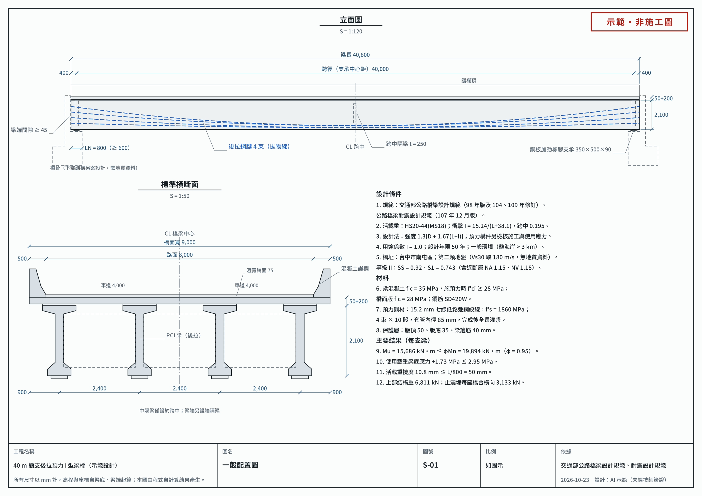
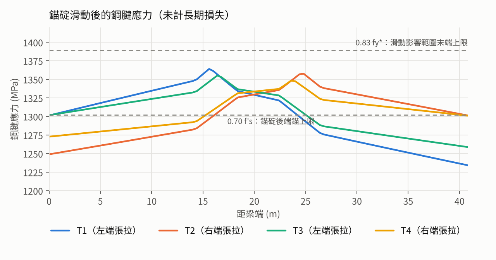

# 我請 AI 依台灣規範設計一座 40 m 預力橋，然後把它開源

2026-10-23 · Kai Chang（2026-10-26 修訂）

結論先講：AI 可以依交通部的「公路橋梁設計規範」與「公路橋梁耐震設計規範」，把一座 40 m 後拉預力 I 型梁橋的上部結構算完，還產生三張設計圖。關鍵數字另用不同方法逐行重算，也因此抓到一個主程式漏掉的錯誤，已經修正。但它不能取代技師簽證，條文沒寫清楚的地方，仍然要人來判斷。

這個實驗的起點是幾個問題：AI 在結構設計裡能做什麼？它會不會一本正經地編出不存在的條文或係數？跟 ETABS、SAP2000、OpenSees 這些工具又是什麼關係？

我的本行是資安與 AI 治理，做稽核的習慣是「不先相信，要能驗證」。所以與其討論，不如請 Claude 實際設計一座橋，再看每個數字能不能追回條文、能不能被另一種算法重現。全部程式與圖面已經以 MIT 授權放在 [GitHub](https://github.com/lcat2000/bridge40)。

## 這座橋

一座單跨 40 m、兩車道的簡支橋，橋址放在台中市南屯區。南屯在耐震規範裡屬於近斷層範圍，對一座示範橋來說是個有點難度的橋址。活載重由我指定 HS20-44，橋址也是我提供的；AI 遇到這兩個需要業主決定的條件時，會停下來問，而不是自己挑一個。

| 項目 | 採用值 |
| --- | --- |
| 主梁 | 4 支後拉預力 I 型梁，梁距 2.4 m，梁高 2.1 m，梁長 40.8 m |
| 預力 | 每支梁 4 束拋物線鋼腱，每束 10 股 15.2 mm 鋼絞線 |
| 橋面 | 寬 9.0 m，版厚 200 mm |
| 混凝土 | 梁 f'c 35 MPa（施預力時 30 MPa），橋面版 28 MPa |
| 活載重 | HS20-44 |
| 地盤 | 第二類（沒有鑽探資料，取保守值） |

修正後，常時與地震檢核全部通過。最緊的是施預力時的梁底壓應力（用掉容許值的 95%）與支承墊壓應力（95%）；撓曲強度比值 0.79，活載重撓度 10.8 mm，限值 50 mm。

真正的難題是地震。等級 II 地震的工址短週期譜加速度達 0.92 g，只靠橡膠支承墊，橋面會位移約 236 mm，是橡膠厚度的 3 倍多。所以設計改成「墊片負責常時伸縮，地震力交給止震塊」：每座橋台橫向 3,133 kN，梁端放在橋台上的長度採 80 cm（規範最少 60 cm）。



上圖是程式產生的三張 A3 圖之一。圖上每個尺寸與數字都從計算結果讀取，不是手動抄上去的。

## 怎麼做的

關鍵只有一個：不讓 AI 憑記憶算。每個係數都要回到規範原文，每個數字都由程式算出來。

1. **先讀規範原文**：從交通部網站取得兩本規範的 PDF，轉成文字後逐段查。例如南屯區的地震係數查耐震規範表 2-4，近斷層調整因子查表 2-7，預力損失公式查設計規範 8.16。這一步也發現台灣的設計規範是以 AASHTO 2002 年版 Standard Specifications 為藍本，不是現在美國用的 LRFD。
2. **結構分析交給 OpenSeesPy**：建一支 800 個元素的簡支梁，把單位載重依序放在每個節點，得到彎矩、剪力、撓度的影響線，再疊加出 HS20-44 卡車與車道載重的包絡。
3. **設計檢核寫成 Python**：鋼腱線形、摩擦、損失、應力、強度、剪力、錨碇區、橋面版、支承、耐震全部是程式，約 2,400 行。鋼絞線股數從 6 股試起，取第一個通過全部檢核的配置。
4. **同一份結果出計算書與圖**：所有輸入都在一個參數檔，結果存成 JSON，計算摘要與三張圖都從這份 JSON 產生。改跨徑或梁距重跑一次，圖上的尺寸就跟著變。

這座橋不是一次就做出來的。先做 20 m 的 HS20 範例，再換成美國 LRFD 的 HL-93 比較，接著依台灣規範重算、加上耐震，最後才把跨徑拉到 40 m。跨徑變成 40 m 後，一支梁重約 86 t，先拉法要整支長途運送不實際，所以改成在橋址附近預鑄、後拉施預力，程式也跟著加上摩擦、錨碇滑動與後拉錨碇區的檢核。

## 怎麼確認 AI 沒算錯

AI 也會算錯，這次就錯了好幾次。重點是每個關鍵數字都用另一種方法再算一次，錯誤才會被抓出來。要先說清楚：下表的獨立核對也是 AI 做的，做法是另寫一支只讀輸入參數的程式，換方法重算；還沒有結構技師逐行複核。

| 檢核項目 | 程式結果 | 獨立核對 | 核對方法 |
| --- | --- | --- | --- |
| HS20-44 卡車最大彎矩 | 2,861.6 kN·m（OpenSees） | 2,861.6 kN·m | 影響線解析解每 2 mm 移動一次，另以經典閉合解復算 |
| 預力損失合計 | 224.5 MPa | 224.5 MPa | AI 依規範公式另行逐步重算（未經人工複核） |
| 使用載重跨中梁底應力 | 2.01 MPa | 2.02 MPa | AI 依規範公式另行逐步重算（未經人工複核） |
| 撓曲強度 φMn | 19,894 kN·m | 19,894 kN·m | AI 依規範公式另行逐步重算（未經人工複核） |
| 斷面慣性矩 | 多邊形公式 | 一致 | 拆塊計算、每 1 mm 薄條積分 |
| 整套程式 | 全部結果 | 完全相同 | 在乾淨目錄解壓後重跑 |

臨界斷面 Vcw、錨碇區爆裂力、支承墊與止震塊也一起重算。公式、條號與代入的數字逐行寫在 repo 的 [checks/hand_checks.md](../checks/hand_checks.md)，供技師一行一行檢查。每束鋼絞線取 10 股不是拍腦袋：改成 9 股重算，使用載重下的梁底拉應力確實超過容許值。



上圖是程式對每束鋼腱做的事：考慮摩擦與錨碇滑動後，找出同時滿足規範三個上限的最大張拉應力。左右交替張拉，讓四束平均起來接近對稱。

過程中實際抓到、並修正的錯誤：

- **最重要的一個**：規範 8.17.1 要求後拉構件在灌漿前計算斷面時，扣除套管開孔，主程式原本沒有扣。扣除後，施預力時梁底壓應力是 −15.7 MPa，超過容許值 −15.4 MPa。修正方式是施預力階段改用淨斷面，並把施預力時的混凝土強度 f'ci 由 28 提高到 30 MPa；修正後為 −15.75 MPa，容許 −16.5 MPa。
- 影響線閉合解的核對第一次就失敗，原因是軸位置公式的正負號寫反。
- 支承拉拔的說明文字把判斷結果寫反了，數字是對的，結論是錯的。
- 計算書寫「每側 3 個止震塊」，實際設計是梁間 3 個、兩個方向共用。
- 剪力說明原本把最不利位置講錯，重看結果後更正為距支承 8.4 m、由 Vci 控制。
- 圖面上的中文字一開始輸出成方塊，標註也互相重疊，是一張一張看過後才修好的。

第一個錯誤是漏了一條條文，程式算得再準也看不出來，只有從條文重新檢查才找得到；其餘大多出在「把數字譯成結論」的那一步。這兩類都是人工審查最該看的地方。

## AI 不該自己決定的事

規範不是每件事都有答案。這次有十幾個地方條文沒有明定，AI 必須自己取值。它全部列成清單、標明「自行判斷」，這比任何一個數字都重要，因為這是技師審查時該先看的地方。

- **鋼腱細節**：側向 S 彎每處 0.10 rad、錨碇滑動 6 mm、摩擦係數取範圍上限。實際值要看廠商的錨碇系統。
- **載重細節**：梁端剪力分配係數怎麼過渡到跨中、欄杆載重要不要乘活載重係數，都取了偏保守的做法。
- **耐震假設**：止震塊設計力取反應譜平台值，因為下部結構的週期未知；縱向力假設由單一橋台承受。
- **地盤**：沒有鑽探資料，只能假設第二類、Vs30 = 180 m/s。幸好南屯區的短週期係數很高，地盤分類對上部結構幾乎沒有影響。

還有一些是這次完全做不了的：橋台、基礎、液化檢核都需要鑽探資料；錨碇區的局部承壓超過一般錨碇座的能力，要採用廠商試驗合格的特殊錨碇裝置。

最後，這是方法示範，不是可以施工的設計。真正的橋要由執業技師負責並簽證，這件事 AI 不能代勞，也不該代勞。

## 開源

程式、三張設計圖、計算摘要、完整設計說明與獨立核對計算書都在 [lcat2000/bridge40](https://github.com/lcat2000/bridge40)，README 有中英文版。裝好套件後兩行就能重算並出圖：

```bash
pip install -r requirements.txt
python run_all.py
```

想改跨徑、梁距或橋址係數，改 `bridge40/params.py` 再跑一次即可。

授權的原則是：有用到別人的東西就延續別人的授權，其餘用 MIT。這個 repo 沒有複製任何人的程式碼，所以本身是 MIT；執行時用到的套件各自適用原授權，列在 [THIRD_PARTY_NOTICES.md](../THIRD_PARTY_NOTICES.md)。其中要特別注意 OpenSeesPy：研究、教學與內部使用免費，但若做成商業產品或雲端服務再散布，需要另外向作者取得授權。

## 心得

AI 最適合的位置，是把規範變成可以執行、可以核對的程式。它不適合當最後決定的人。它快、不怕重算，也能一次照顧幾百個細節；但細節一多，錯誤就藏在「結論寫反」「數量講錯」這種地方，而不是公式裡。

想試試的人，我的建議是：

1. **給它原文，不要讓它憑記憶**。規範版本、表格係數都要能指到條號。
2. **要求獨立核對**。同一個數字用另一種方法再算一次，兩者不一致就停下來查。
3. **讓它列出自己的假設**。條文沒寫的地方最容易被悄悄帶過，清單就是審查的起點。
4. **業主該決定的事自己決定**。橋址、載重等級、要不要保守，都不該讓 AI 替你選。
5. **最後一關給人**。對工程負責的是簽字的技師，不是模型。

做稽核的人常說「沒有紀錄就等於沒做」。這次最大的收穫不是算出一座橋，而是每一步都留下了可以被他人重現、挑戰的紀錄。歡迎到 GitHub 上開 issue 指正。
