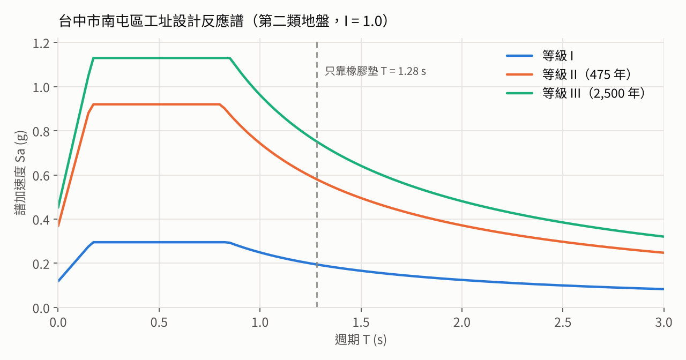
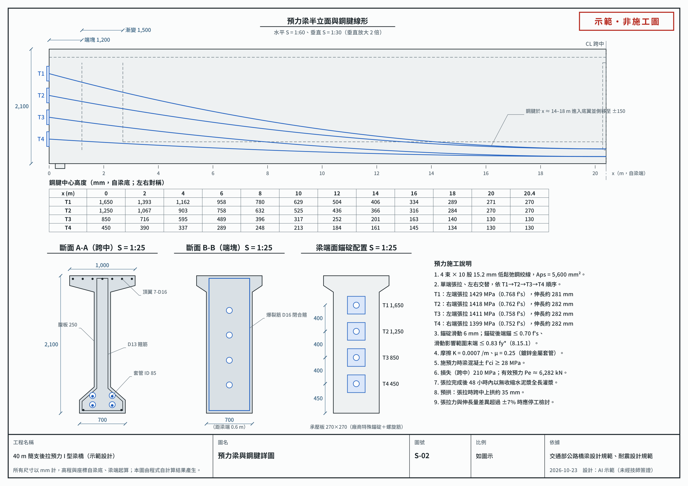
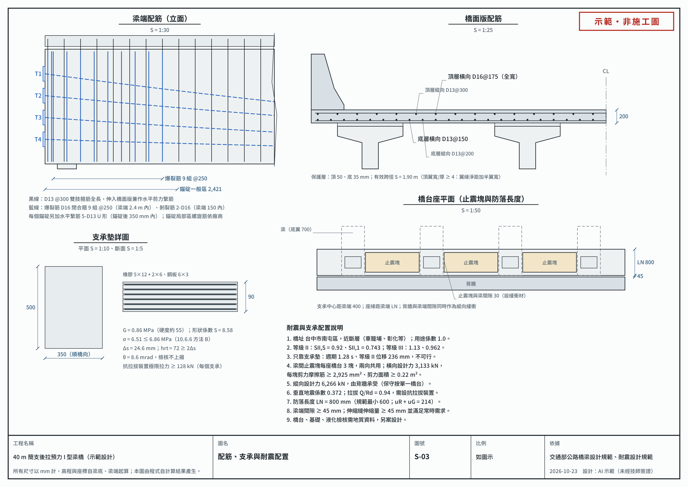

# 40 m 後拉預力 I 型梁橋設計：依交通部公路橋梁設計與耐震規範

2026-10-23 · Kai Chang

## 重點摘要

這座 40 m 單跨橋用 4 支 2.1 m 高的後拉預力 I 型梁，每支梁 4 束、每束 10 股 15.2 mm 鋼絞線。依交通部兩本規範做的常時與地震檢核全部通過。最緊的兩項是施預力時的梁底壓應力（用掉 94%）與支承墊壓應力（95%）。設計上最需要處理的是地震：只靠橡膠支承墊會有約 240 mm 的位移，必須設止震塊。

- **強度**：每支梁 Mu = 15,686 kN·m，φMn = 19,894 kN·m，比值 0.79。
- **預力**：張拉應力 1,399–1,429 MPa，由「錨碇後端錨 ≤ 0.70 f's」控制；跨中有效應力 1,122 MPa，每支梁有效預力 6,282 kN。
- **使用應力**：梁底拉應力 1.73 MPa，容許 2.95 MPa；活載重撓度 10.8 mm，限值 50 mm。
- **剪力**：混凝土就足以承受，箍筋由橋面版介面的最小繫筋控制，D13@300 全長。
- **錨碇區**：爆裂力 1,237 kN，配 9 組 D16 閉合箍。一般錨碇座的承壓不足，需採用廠商試驗合格的特殊錨碇裝置。
- **支承墊**：350 × 500 × 90 mm，壓應力 6.51 MPa，上限 6.86 MPa。
- **耐震**：橋址台中市南屯區屬近斷層範圍，等級 II 地震譜加速度 0.92 g。止震塊每座橋台橫向 3,133 kN、縱向 6,266 kN；防落長度採 800 mm（規範最小 600 mm）；每個支承需抗拉拔 128 kN。
- **還沒做的**：橋台、基礎與液化檢核需要鑽探資料。本文是方法示範，不是可施工的設計，實際設計須由執業技師負責並簽證。

## 橋梁概要與設計條件

主梁採後拉預力 I 型梁。一支梁長 40.8 m、重約 86 t，先張法需要長途運送整支梁，故改在橋址附近預鑄、後拉施預力後吊裝。下表「來源」一欄區分條文規定與本示範自行取的值。

| 項目 | 採用值 | 來源 |
| --- | --- | --- |
| 橋型 | 單跨簡支，支承中心距 40 m，梁長 40.8 m，兩端橋台 | 假設 |
| 橋面 | 寬 9.0 m，兩側護欄各 0.5 m，路面 8.0 m（兩車道）；版厚 200 mm、托肩 50 mm、熀青鋪面 75 mm | 假設 |
| 主梁 | 4 支，梁距 2.4 m，梁高 2.1 m；頂翼 1,000 × 150、腹板 250、底翼 700 × 200 mm；梁端 1.2 m 加厚到 700 mm，再以 1.5 m 漸變 | 假設 |
| 隔梁 | 梁端與跨中各一道 | 8.10.2（跨徑 > 12 m 須設中隔梁） |
| 鋼腱 | 4 束拋物線；梁端錨碇高 450～1,650 mm，跨中兩排兩列位於底翼 | 假設 |
| 橋址 | 台中市南屯區（24.1226, 120.6477） | 設計條件 |
| 活載重 | HS20-44(MS18)，不乘 1.25 | 指定；1.25 倍用於省市重要道路與國道 |
| 用途係數、設計年限 | I = 1.0；50 年 | 耐震表 2-1；設計規範 12.2 |
| 環境與保護層 | 一般環境作用等級 II；版頂 50、版底 35（水膠比 ≤ 0.45）、梁箍筋 40 mm | 表 7.2 與表 12.2 取大值 |
| 混凝土 | 梁 f'c 35 MPa，施預力時 f'ci 28 MPa；版 28 MPa；Ec = 0.0428 w¹˙⁵ √f'c，w = 2,320 kg/m³ | 假設；8-8 式；f'ci 符合 8.23 |
| 預力鋼材 | 15.2 mm 低鬆弛鋼絞線，f's = 1,860 MPa，Ep = 193 GPa；套管內徑 85 mm | 8.16.2；表 8.3 |
| 鋼筋 | SD420W | 假設 |
| 單位重 | 鋼筋混凝土與路面都是 2,400 kgf/m³ | 3.3 |
| 摩擦與滑動 | K = 0.0007/m、μ = 0.25；錨碇滑動 6 mm；鋼腱側向 S 彎每處 0.10 rad | 表 8.1；滑動量與側彎為假設 |
| 環境參數 | 年平均相對濕度 80%；溫度升降 20 °C；線膨脹係數 10.8 × 10⁻⁶/°C | 8.16.2、3.16；係數條文未列 |
| 地盤 | 第二類，Vs30 取 180 m/s | 無鑽探資料，取放大係數最大的值 |

## 依循的規範與版本

兩本都是交通部現行版。設計規範以 AASHTO 2002 年版 Standard Specifications 為藍本，強度用載重因數設計，預力構件在施工與使用階段另須符合容許應力（8.13.1）。

| 規範 | 版本 | 本次用到的章節 |
| --- | --- | --- |
| [公路橋梁設計規範](https://www.motc.gov.tw/ch/app/data/view?module=divpubreg&id=740&serno=424) | 98 年 12 月本文；104 年 4 月修訂 7.1.5 與第 12 章（耐久性）；109 年 1 月修訂 1.1、1.4（不影響計算） | 2.9 欄杆載重；3 載重與組合；4 輪重分擔與橋面版；7 鋼筋混凝土；8 預力混凝土（摩擦、損失、容許應力、強度、剪力、後拉錨碇區）；10.6.6 支承；12 耐久性 |
| [公路橋梁耐震設計規範](https://www.motc.gov.tw/ch/app/divpubreg_list/view?module=divpubreg&id=740&serno=419) | 107 年 12 月版，108 年 1 月 14 日頒布（交技(108)字第1085000530號） | 2.2 地盤分類；2.3 設計總橫力；2.5 活動支承；2.6 垂直地震力；4.1 載重組合；4.5 支承系統；8.5–8.7 防落長度、梁端間隙、伸縮量；表 2-1–2-8 |

幾個與本橋直接相關的條文細節：

- 後拉場鑄構件的撓曲強度折減因數是 0.95，廠製預鑄為 1.0（8.14）。
- 後拉構件施預力時的壓應力上限是 0.55 f'ci，比先拉的 0.60 f'ci 嚴（8.15.2）。
- 錨碇後端錨處 ≤ 0.70 f's、滑動影響範圍末端 ≤ 0.83 fy\*，暫時施預力 ≤ 0.90 fy\*（8.15.1）。
- 錨碇區的乘因數預力取最大張拉力的 1.2 倍，φ = 0.85（8.14、8.21）。
- 耐震規範把設計地震分成三級：等級 I（等級 II 的 1/3.25）、等級 II（475 年）、等級 III（2,500 年）。

$$
M_u = 1.3\,[\,D + 1.67\,(L+I)\,],\qquad I = \frac{15.24}{L+38.1} \le 0.30
$$

## 使用的系統與程式

全部計算與出圖由一個 Python 套件 `bridge40` 完成，約 2,400 行。所有輸入放在同一個參數檔，圖面上的尺寸與數字都從計算結果讀取，改參數後重跑一次，計算書與圖面會一起更新。

1. **參數**（`params.py`）：幾何、材料、鋼腱位置、載重、橋址與地震係數。
2. **斷面**（`section.py`）：多邊形公式求面積與慣性矩，另用拆塊手算與 1 mm 薄條積分各核對一次；依 8.8.3 求有效翼寬與合成斷面。
3. **結構分析**（`analysis.py`）：OpenSeesPy 建 800 個元素的簡支梁，單位載重依序放在每個節點，建立彎矩、剪力、撓度的影響線矩陣，再以疊加求 HS20-44 雙向移動的包絡。
4. **獨立核對**：影響線解析解每 2 mm 移動一次，卡車最大彎矩與 OpenSees 都是 2,861.6 kN·m；經典「軸與合力對稱於跨中」的閉合解也得到同一個數。
5. **設計檢核**（`design.py`）：鋼腱線形、摩擦與錨碇滑動、預力損失、施預力與使用應力、強度、撓度與預拱、剪力、錨碇區、橋面版、支承墊、耐震。鋼絞線股數從 6 股試起，取第一個通過全部應力檢核的配置。
6. **輸出**（`report.py`、`drawings.py`、`page.py`）：計算摘要、JSON 結果、三張 A3 設計圖（SVG、PNG、PDF）與網頁版圖面。

關鍵數字另外手算核對過：跨中梁底應力、φMn、各項損失、支點卡車剪力、臨界斷面 Vcw、爆裂力、支承墊應力、止震塊設計力，結果一致。程式也在乾淨目錄解壓後重跑一次，結果相同。

```bash
pip install numpy openseespy cairosvg pypdf
python run_all.py      # 結果輸出到 out/
```

## 載重與結構分析

每支梁跨中的乘因數彎矩 Mu = 15,686 kN·m，其中呆載重佔大半；活載重加衝擊是 2,487 kN·m。

| 跨中彎矩（每支梁） | kN·m | 作用於 |
| --- | --- | --- |
| 梁自重（含梁端加厚） | 3,835 | 梁斷面 |
| 橋面版、托肩、跨中隔梁 | 2,697 | 梁斷面 |
| 護欄、鋪面 | 1,386 | 合成斷面 |
| 活載重加衝擊 | 2,487 | 合成斷面 |
| Mu = 1.3[D + 1.67(L+I)] | 15,686 |  |

**呆載重**（每支梁）：梁 19.06、版 11.30、托肩 1.18、護欄 3.40、鋪面 3.53 kN/m；跨中隔梁 20.2 kN，梁端隔梁 23.4 kN 只進支承反力。支承呆載重反力 851 kN。

**HS20-44**：軸重 36 + 144 + 144 kN。後軸距從 4.25 m 掃到 9.15 m，彎矩由 2,862 降到 2,531 kN·m，取 4.25 m。車道載重（9.4 kN/m 加 80 kN）的彎矩是 2,680 kN·m，由卡車控制；但支點剪力車道載重 304 kN 略大於卡車 301 kN，40 m 已接近兩者交替的跨徑。

**衝擊**：I = 15.24/(40 + 38.1) = 0.195；剪力的載重長度取斷面到較遠支點，跨中為 0.26。每車道含衝擊彎矩 3,420 kN·m、支點剪力 363 kN。

**輪重分擔**：

- 內梁依表 4.1 取 S/1.65 = 1.455 輪重線（0.727 車道）。
- 外梁以橋面版簡支於梁的槓桿法只得 1.083，但規範要求不得低於內梁，四支梁都用 1.455。
- 梁端剪力依規定用簡支法分配，得 1.75。往跨中本例讓它線性過渡到 L/4 處的 1.455；條文沒有規定過渡方式，這是偏保守的做法。

## 後拉預力：鋼腱、摩擦與損失

每支梁 4 束 × 10 股（Aps = 5,600 mm²）。張拉應力由錨碇後端錨 ≤ 0.70 f's 控制，跨中扣除全部損失後的有效應力是 1,122 MPa，有效預力 6,282 kN。

**線形**：四束都是拋物線。梁端錨碇高 450、850、1,250、1,650 mm，合力在 1,050 mm，接近端塊形心 1,087 mm，所以梁端幾乎沒有偏心彎矩，施預力時梁頂全程受壓。跨中兩排兩列在底翼（高 130、270 mm，左右 ±150 mm），重心 200 mm，偏心 876 mm。

**張拉**：單端張拉、左右交替，順序 T1→T4。摩擦依 8-1 式，轉角含垂直拋物線與底翼內的側向 S 彎。程式對每束找出同時滿足三個上限的最大張拉應力：

| 鋼腱 | 張拉端 | 張拉應力 MPa | 錨碇後端錨 MPa | 峰值 MPa | 滑動影響範圍 m | 伸長量 mm |
| --- | --- | --- | --- | --- | --- | --- |
| T1 | 左 | 1,429 | 1,301 | 1,365 | 15.7 | 281 |
| T2 | 右 | 1,418 | 1,301 | 1,359 | 16.2 | 282 |
| T3 | 左 | 1,411 | 1,302 | 1,356 | 16.5 | 282 |
| T4 | 右 | 1,399 | 1,301 | 1,350 | 17.1 | 282 |
| 上限 |  | 0.90 fy\* = 1,507 | 0.70 f's = 1,302 | 0.83 fy\* = 1,389 |  |  |

**預力損失**（跨中，8.16.2）合計 209.6 MPa：

- 乾縮 SH = 0.8(117.2 − 1.034 × 80) = 27.6 MPa（後拉乘 0.8）。
- 彈性縮短 ES = 0.5 (Ep/Eci) fcir = 51.2 MPa，fcir = 13.43 MPa（依序張拉取一半）。
- 潛變 CRc = 12 fcir − 7 fcds = 108.2 MPa，fcds = 7.57 MPa。
- 鬆弛 CRs = 34.5 − 0.07 FR − 0.1 ES − 0.05(SH + CRc) = 22.6 MPa；跨中摩擦後應力仍高於 0.70 f's，FR = 0。


*bridge40 程式計算結果（results.json）· 每 1.2 m 取樣*

錨碇滑動在張拉端附近 16 m 內把應力拉低，但跨中不受影響；左右交替張拉讓四束平均應力在全梁長接近對稱。

## 應力與強度檢核

所有應力與強度檢核都通過，最接近上限的是施預力時的梁底壓應力（0.94）。每束鋼絞線取 10 股是因為 9 股時使用載重下梁底拉應力超過 2.95 MPa。應力沿梁長每 0.1 m 檢核一次，梁端加厚段用實際斷面。壓為負、拉為正。

| 檢核 | 計算值 | 容許值 | 比值 |
| --- | --- | --- | --- |
| 施預力時梁底壓應力 | −14.48 MPa | 0.55 f'ci = −15.40 | 0.94 |
| 施預力時梁頂 | −3.50 MPa（全程受壓） | 拉 ≤ 1.32 | — |
| 使用載重梁底拉應力 D+(L+I) | +1.73 MPa | 0.498√f'c = 2.95 | 0.59 |
| 梁頂 Pe + 呆載重 | −11.19 MPa | 0.40 f'c = −14.0 | 0.80 |
| 梁頂 0.5(Pe + 呆載重) + 活載重 | −7.45 MPa | 0.40 f'c = −14.0 | 0.53 |
| 梁頂全載重 | −13.05 MPa | 0.60 f'c = −21.0 | 0.62 |
| 橋面版頂 | −3.64 MPa | 0.60 f'c = −16.8 | 0.22 |
| 鋼腱損失後最大應力 | 1,155 MPa | 0.80 fy\* = 1,339 | 0.86 |
| 撓曲強度 Mu ≤ φMn（全梁最不利） | 15,686 kN·m | 19,894 kN·m | 0.79 |
| 最少鋼材量 1.2 Mcr\* ≤ φMn | 13,788 kN·m | 19,894 kN·m | 0.69 |
| 鋼材量指數 p\* fsu\*/f'c | 0.070 | 0.36β1 = 0.306 | 0.23 |
| 活載重加衝擊撓度 | 10.8 mm | L/800 = 50 mm | 0.22 |

- **強度**：後拉場鑄 φ = 0.95；fsu\* = 1,816 MPa，等值應力塊深 178 mm，小於版厚 200 mm，按矩形斷面計算。
- **施預力時**：梁在預鑄場以梁長 40.8 m 自重承受預力，Pi = 7,169 kN。梁端錨碇合力接近形心，梁頂不出現拉應力，不需額外的頂翼握裹鋼筋；圖上配的 7-D16 是構造筋。
- **預拱**：張拉時跨中上拱約 35 mm；加上橋面版、護欄、鋪面與損失後，瞬時計算為下垂約 21 mm。未計潛變對上拱與下垂的長期放大，托肩厚度與橋面高程應依實測上拱調整。

## 剪力、水平剪力與錨碇區

混凝土加上預力的垂直分力已足以承受剪力，箍筋由橋面版介面的最小繫筋控制，採 D13 雙肢 @300 全長，全梁最大 Vu/φVn = 0.68。錨碇區則需要大量爆裂筋。

**剪力**（8.20）：支點 Vu = 1.3[VD + 1.67 V(L+I)] = 1,671 kN。臨界斷面在支承面外 h/2，即距支承中心 1.35 m，位於梁端加厚的漸變段（腹板寬 535 mm）：

- Vu = 1,548 kN。
- Vci = 4,368 kN，Vcw = (0.29√f'c + 0.3 fpc) b'd + Vp = 3,580 kN；fpc = 4.63 MPa，Vp = 458 kN，d = 1,880 mm（取 0.8h 下限）。
- Vu/φ = 1,720 kN 小於 Vc，不需剪力箍筋；最少箍筋 Av = 0.345 b's/fsy 與最大間距 600 mm 使需求為 D13 @550～600。

距支承 4 m 以後改由 Vci 控制；在 6～12 m 之間 Vci 略小於 Vu/φ，需要的 Vs 很小，最少箍筋即足。最不利在距支承 8.4 m 處，以 @300 計 Vu/φVn = 0.68。規範的 b' 不扣除套管，本例亦未扣除。

**水平剪力**（8.20.4）：介面刻意粗糙約 6 mm 且有最小繫筋時，Vnh = 2.40 MPa × bv × d，φVnh = 0.9 × 2.40 × 1,000 × 2,350 = 5,076 kN，遠大於 1,671 kN。但最小繫筋 Av ≥ 0.345 bv s/fy，bv 取頂翼寬 1,000 mm，D13 雙肢間距需 ≤ 308 mm。箍筋伸入橋面版兼作繫筋，所以全長採 @300。

**錨碇區**（8.21，乘因數預力 Pu = 1.2 × 張拉力 ≈ 2,400 kN/束，φ = 0.85）：

- 垂直爆裂力依 8-37 式、考慮張拉順序：前 3 束張拉後最大，Tburst = 1,237 kN，dburst = 968 mm。需 As = 3,464 mm²，配 9 組 D16 閉合箍，分佈於梁端 2.4 m 內。
- 水平爆裂力（端塊寬 700 mm）每束 369 kN，每個錨碇後配 5-D13 U 形繫筋。
- 剥裂力取 2% 乘因數預力 = 190 kN，梁端面 150 mm 內配 2-D16 閉合箍。
- 局部區承壓：一般錨碇座 fb = 36.2 MPa，超過 8-39 式的 24.7 MPa。必須採用廠商依 8.21.7.3 試驗合格的特殊錨碇裝置（含螺旋筋），並依廠商要求的施預力時強度與邊距設計。

## 橋面版與懸臂

橋面版底層橫向 D13@150、頂層橫向 D16@175（全寬），頂層由欄杆載重控制。主筋垂直車行方向，用規範 4.3 的經驗彎矩式。

$$
M_{L} = 0.8 \times \frac{S + 0.6}{9.6}\, P_{20} = 0.8 \times \frac{1.9 + 0.6}{9.6} \times 72 = 15.0\ \text{kN·m/m}
$$

- **有效跨徑**：梁頂翼寬 1,000 mm、厚 150 mm，比值 6.7 ≥ 4，屬「薄上翼板」，S 取翼緣淨距 1.4 m 加半翼寬 0.5 m = 1.9 m。
- **衝擊**：15.24/(1.9 + 38.1) = 0.38，取上限 0.30，M(L+I) = 19.5 kN·m/m。呆載重 6.48 kN/m² 以 wS²/10 得 2.3 kN·m/m。
- **正負彎矩** Mu = 1.3(2.3 + 1.67 × 19.5) = 45.4 kN·m/m。底層 d = 158.5 mm 需 792 mm²/m，配 D13@150（845）；頂層 d = 143.5 mm 需 885 mm²/m。
- **懸臂**：外梁翼緣距版緣只有 0.4 m，在護欄底下。橋面版設計的輪重放在距欄杆面 0.3 m（距版緣 0.8 m），落在翼板內側，對懸臂不產生彎矩。控制的是欄杆集中載重 44.5 kN：分佈寬 E = 0.8X + 1.52 = 1.68 m，彎矩 25.2 kN·m/m。按活載重係數乘 1.3 × 1.67（條文未明定，取保守側）得 Mu = 56.9 kN·m/m，需 1,127 mm²/m，配 D16@175（1,135），全寬統一使用。
- **縱向筋**：底層分佈筋 121/√S = 88%，取上限 67%，需 566 mm²/m，配 D13@200。頂層乾縮溫度筋最少 2.7 cm²/m、間距 ≤ 45 cm，採 D13@300。
- **裂縫與疲勞**：使用載重下鋼筋應力 178、183 MPa，低於 7.3.10 的 252 MPa（z = 30 MN/m）；依 7.3.9，用此近似法設計的橋面版免檢核疲勞。

若實際採用通過撞擊測試的護欄，懸臂應改用該護欄的設計載重再檢核一次。

## 支承墊

每支梁兩端各一個 350 × 500 × 90 mm 鋼板加勁橡膠支承，依 10.6.6「方法 B」檢核全部通過，壓應力用掉 95%。程式在幾種尺寸與層厚中挑面積最小、再取高度最低的組合。

墊片組成：內層橡膠 5 × 12 mm、外層 2 × 6 mm（橡膠總厚 72 mm）、鋼板 6 × 3 mm；硬度約 55，G = 0.86 MPa，形狀係數 S = 8.58。每個支承反力：呆載重 851 kN、活載重含衝擊 287 kN。

| 檢核 | 計算值 | 限值 | 比值 |
| --- | --- | --- | --- |
| 平均壓應力 σTL | 6.51 MPa | min(70 kgf/cm² = 6.86, 1.0GS = 7.38) | 0.95 |
| 剪變形 hrt ≥ 2Δs | 2 × 24.6 = 49.3 mm | hrt = 72 mm | 0.68 |
| 不上揚 σTL ≥ 0.5GS(L/hri)²θ/n | 需 5.38 MPa | 有 6.51 MPa | 0.83 |
| 穩定：總厚 ≤ L/3 | 90 mm | 116.7 mm | 0.77 |
| 鋼板厚 | 需 0.94 mm | 3 mm | 0.31 |

- 水平位移 Δs = 溫度 ±20 °C 的 8.6 mm + 架設後乾縮潛變 16.0 mm。保守假設全跨伸縮由一端承受。
- 轉角 θ = 8.6 mrad：預力與呆載重 2.1、活載重 1.4、施工誤差 5.0 mrad。
- 這個墊片只負責常時的伸縮與轉動，地震力交給止震塊，見下一節。

## 耐震：台中市南屯區

南屯區列在近斷層範圍內，等級 II 地震的工址短週期譜加速度是 0.92 g。上部結構本身承得住，弱點在支承：只靠橡膠墊會有 236 mm 的位移，必須設止震塊；梁端放在橋台上的長度至少 60 cm，採 80 cm。

### 地震參數

耐震規範表 2-4 把南屯區列為鄰近大甲斷層全段、鐵砧山斷層、彰化斷層與車籠埔斷層全段。表 2-7 的調整因子整個行政區用同一組；鄰近兩個以上斷層時，NA 與 NV 各取較大值（解說 C2.3）。等級 I 視為遠域地震，不考慮近斷層。用途係數 I = 1.0。

| 項目 | 等級 I | 等級 II | 等級 III |
| --- | --- | --- | --- |
| 回歸期 | 等級 II 的 1/3.25 | 475 年 | 2,500 年 |
| 堅實地盤 SS / S1（表 2-4） | 0.246 / 0.138 | 0.80 / 0.45 | 1.00 / 0.55 |
| 近斷層 NA / NV（表 2-7） | 不考慮 | 1.15（彰化等）/ 1.18（車籠埔） | 1.13 / 1.25（車籠埔） |
| 地盤放大 Fa / Fv（第二類） | 1.2 / 1.8 | 1.0 / 1.4 | 1.0 / 1.4 |
| 工址 SS / S1 | 0.295 / 0.249 | 0.920 / 0.743 | 1.130 / 0.962 |
| 平台終點 T0 | 0.84 s | 0.81 s | 0.85 s |



*依耐震規範式 2-5、2-13、2-20 與表 2-3、2-4、2-7 計算 · bridge40 程式*

短週期段的高度由近斷層調整決定，地盤只影響平台之後的曲線。虛線是上部結構只靠 8 個橡膠墊時的週期。

### 只靠支承墊不行

上部結構重 W = 6,811 kN，放在 8 個橡膠墊上，每個水平勁度 GA/hrt = 2,090 kN/m，週期 T = 1.28 s。

- 等級 II 位移 236 mm，是橡膠總厚 72 mm 的 3.3 倍；等級 III 達 306 mm。
- 墊片摩擦（表 2-8，合成橡膠墊 0.15）只能傳 1,022 kN，需求是 6,266 kN。

### 止震塊的設計力

單跨橋兩端都是橋台，沒有橋柱塑鉸可以限制傳到支承的力。依 4.5.2，支承系統取等級 II 彈性力 I · Sa,II · W；橋台與基礎勁度未知，週期取平台值 0.92。

- 全橋 6,266 kN；每座橋台橫向 3,133 kN；縱向保守假設由一座橋台背牆承受 6,266 kN。
- 每座橋台在梁間設 3 個止震塊，兩向共用，每塊分擔 1,044 kN。以剪力摩擦估算（7.3.6；後澆於粗糙座面 μ = 1.0，φ = 0.85）：每塊穿越接縫的鋼筋 ≥ 2,925 mm²（例如 6-D25），剪力面積 ≥ 0.22 m²。
- 若下部結構模型算出週期小於 0.16 s，Sa 會往 0.37 下降，上述力量最多可減到約 40%。

### 垂直地震力

近斷層橋梁要考慮垂直地震力，預力上部結構也要檢核（2.6）。垂直係數 (2/3)(1.0)(0.92)/1.65 = 0.372。

- 向下：Mu = 1.3 × 1.372 × 呆載重 = 14,120 kN·m，小於 φMn 19,894 kN·m。以使用應力看，梁底會出現 +4.2 MPa，超過 1.33 倍容許拉應力 3.9 MPa，極端垂直地震下可能有細微裂縫；規範 4.1 對預力構件以強度檢核，強度通過。
- 向上：呆載重只剩 63%，梁頂 −5.1 MPa、梁底 −9.6 MPa，全斷面受壓。

### 支承的垂直力與拉拔

橫向地震力作用在支承底上 1.81 m 的重心，對外梁支承產生 ±709 kN；垂直地震產生 ±316 kN；呆載重反力 Rd = 851 kN。

- 垂直設計壓力 RBV = 1,655 kN，在墊片上是 9.5 MPa。規範要求支承極限承載力不小於此值，需由廠商試驗證明。
- 拉拔力 Q = 709 + 0.3 × 316 = 804 kN，是 Rd 的 94%。落在 50%～100% 之間，需設抗拉拔裝置：容許應力設計取 0.10 Rd = 85 kN，極限承載力 ≥ 0.15 Rd = 128 kN（每個支承）。
- 這是用彈性力算的保守值。若下部結構確定後以折減後的設計總橫力計算，Q 可能低於 0.5 Rd。

### 防落長度、梁端間隙與伸縮量

- **最小防落長度** LN,min = 50 + 0.25L + 1.0H = 60 cm（單跨橋 H = 0，無斜角）。
- **活動支承另需** LN ≥ uR + uG：地盤相對變位 uG = 0.00375 × 4,000 cm × 1.13/0.92 = 18.4 cm；止震塊間隙取 3.0 cm，合計 21.4 cm，由 60 cm 控制。
- **採用 80 cm**：支承中心距梁端 40 cm，墊片半長 17.5 cm，再留 22.5 cm 座緣距。
- **梁端間隙**與**伸縮縫**至少 3.0 + 1.5 = 4.5 cm，並滿足常時伸縮。只靠墊片時間隙要 25 cm。
- **防止落橋裝置**：8.5 只對重要橋梁或大坡度橋梁要求，本例不強制。

## 設計圖與程式檔案

三張 A3 設計圖由程式從計算結果直接產生，圖上的尺寸、鋼腱座標、配筋與耐震數字都讀自同一份結果。圖檔都在 `out/`：每張圖各有 SVG 與 PNG，`drawings_40m.pdf` 是三張合併的 PDF，`drawings_page.html` 是可切換亮暗主題、可放大的網頁版。

| 圖號 | 圖名 | 內容 |
| --- | --- | --- |
| S-01 | 一般配置圖 | 立面（1:120）、標準橫斷面（1:50）、設計條件與主要結果 |
| S-02 | 預力梁與鋼腱詳圖 | 半立面與鋼腱線形、鋼腱座標表、跨中與端塊斷面、梁端錨碇配置、預力施工說明 |
| S-03 | 配筋、支承與耐震配置 | 梁端配筋、橋面版配筋、支承墊詳圖、橋台座平面（止震塊與防落長度）、耐震說明 |






repo 內容：

- `bridge40/`：七個模組（參數、斷面、分析、設計、報告、圖面、網頁）。
- `run_all.py`：一次執行全部計算與出圖。
- `README.md`：安裝、執行、模組說明與假設清單。
- `out/`：本文引用的計算摘要（`calc_report.txt`）與全部結果（`results.json`），以及三張設計圖。
- `docs/`：本文，以及由 `results.json` 產生本文兩張圖的 `make_figures.py`。

要改跨徑、梁距、鋼腱位置或橋址係數，改 `params.py` 再執行 `python run_all.py`，計算書與三張圖的尺寸、數字會一起更新；部分標註位置可能需要微調。

## 沒有地質資料的影響

對上部結構、止震塊設計力與防落長度幾乎沒有影響，對下部結構與基礎則是決定性的。南屯區短週期係數經近斷層放大後達 0.92，超過 0.8，三類地盤的 Fa 都是 1.0，反應譜平台高度不變；地盤只改變平台後的長週期段。

| 地盤 | 等級 II 的 Fv | 工址 S1 | 只靠墊片時的位移 | 地盤相對變位 uG |
| --- | --- | --- | --- | --- |
| 第一類（Vs30 ≥ 270 m/s） | 1.0 | 0.531 | 169 mm | 12.3 cm |
| 第二類，Vs30 = 225 m/s | 1.2 | 0.637 | 203 mm | 18.4 cm |
| 第二類，Vs30 = 180 m/s（本文採用） | 1.4 | 0.743 | 236 mm | 18.4 cm |
| 第三類（Vs30 < 180 m/s） | 1.4 | 0.743 | 236 mm | 24.6 cm |

- **不受影響**：止震塊設計力（取平台值）、垂直地震係數 0.372、最小防落長度 60 cm（各類地盤的 uR + uG 都不到 30 cm）。
- **會變的**：週期較長時的需求、只靠墊片時的位移、uG。
- **算不了的**：橋台與基礎的勁度與承載力、背填土的地震土壓力、液化（耐震規範 8.1），以及用折減後設計力重算的拉拔。週期確定後，止震塊與拉拔力有機會下修。

台中盆地常見卵礫石層，若鑽探證實 Vs30 ≥ 270 m/s 就屬第一類，本文的假設偏保守。至少需要：兩端橋台各一孔鑽探、含 SPT-N 與地下水位，以及實測或推估的 Vs30。

## 限制與資料來源

這是方法示範，不是可施工的設計；實際設計需由執業技師負責並簽證。

**條文沒有明定、由本例自行判斷的項目**（檢討時可先看這些）：

- 鋼腱側向 S 彎每處 0.10 rad、錨碇滑動 6 mm、摩擦係數 μ 取表 8.1 範圍 0.15～0.25 的上限。
- 梁端剪力分配係數從 1.75 線性過渡到 L/4 的 1.455。
- 欄杆載重乘活載重係數 1.3 × 1.67。
- 止震塊設計力取反應譜平台值；縱向由單一橋台承受；間隙 30 mm；三個梁間止震塊平均分擔。
- 拉拔檢核用彈性水平力，不是折減後的設計總橫力。
- 架設後乾縮潛變縮短 0.0004 L；Vs30 取 180 m/s。

**還沒做的**：橋台與基礎、液化、背牆地震土壓力、止震塊與抗拉拔裝置的細部、吊裝與運輸階段、上拱與下垂的長期潛變、錨碇裝置的廠商資料。

**資料來源**

- [交通部：公路橋梁設計規範（含 104、109 年修訂檔）](https://www.motc.gov.tw/ch/app/data/view?module=divpubreg&id=740&serno=424)
- [交通部：公路橋梁耐震設計規範（107 年 12 月版）](https://www.motc.gov.tw/ch/app/divpubreg_list/view?module=divpubreg&id=740&serno=419)
